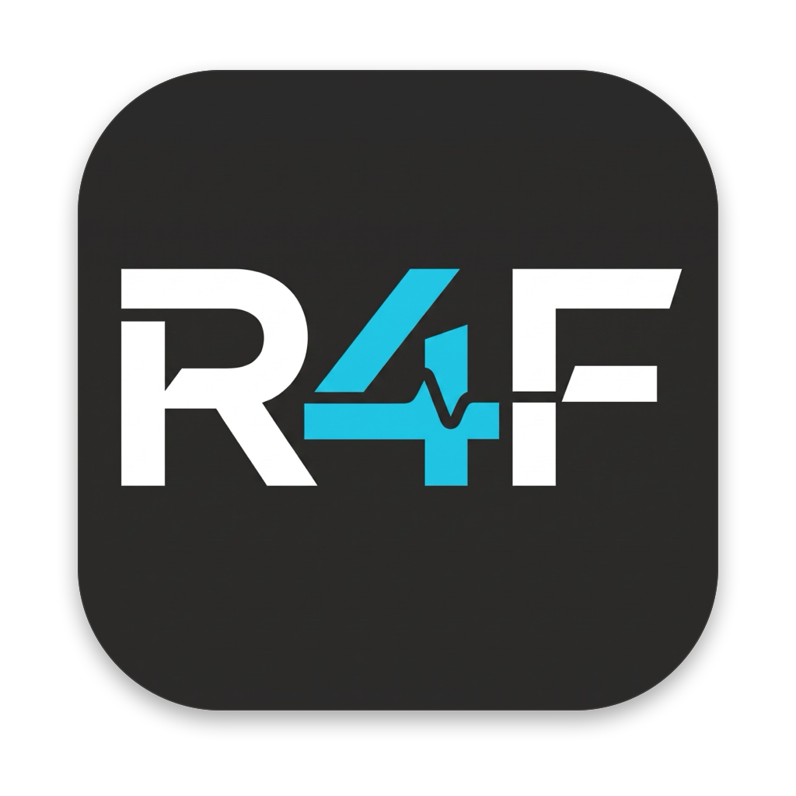
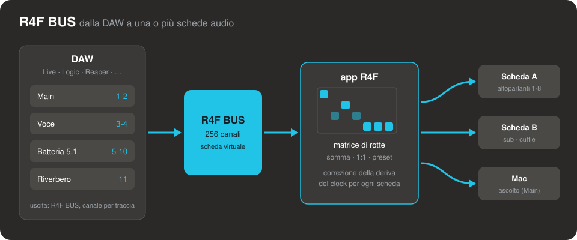
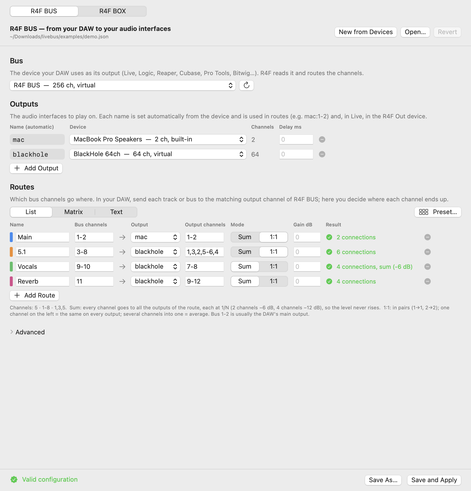
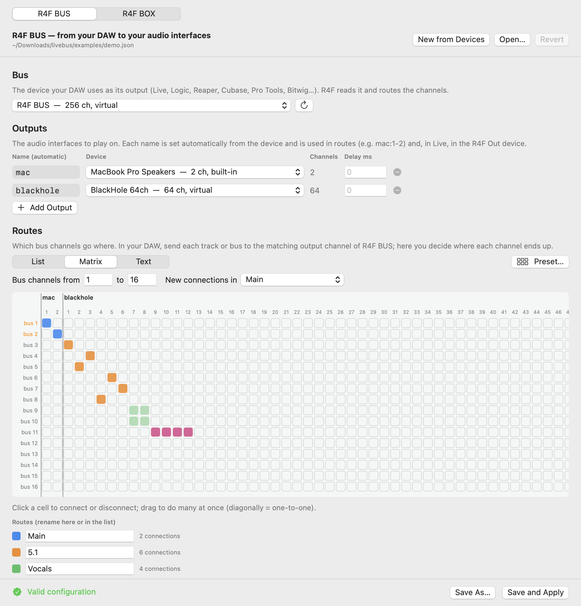
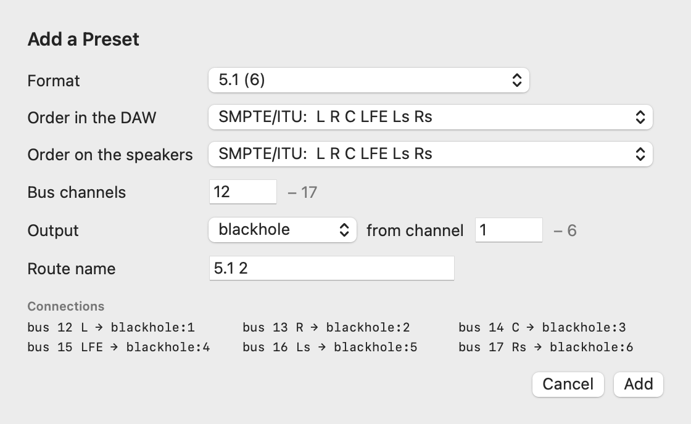
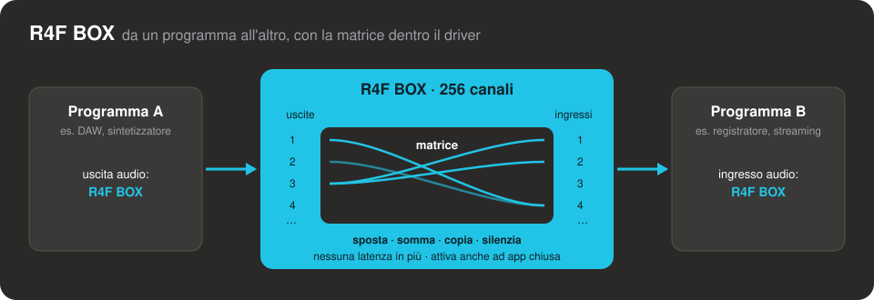
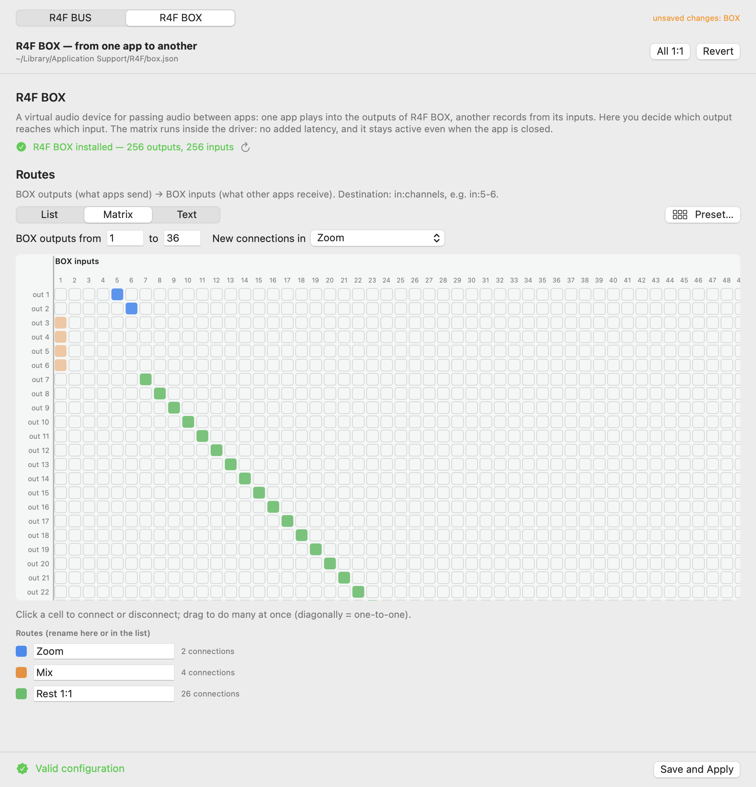

<p align="center">
  
</p>

<h1 align="center">R4F</h1>

<p align="center">
  Audio multicanale per macOS: dalla DAW a più schede audio, e da un programma all'altro.
</p>

<p align="center">
  <a href="https://github.com/Raf0404/R4F/releases/latest"><b>⬇︎ Scarica l'installer (.pkg)</b></a>
  &nbsp;·&nbsp; macOS 13 o successivo &nbsp;·&nbsp; Apple Silicon e Intel &nbsp;·&nbsp; <a href="#licenza">GPL-3.0</a>
</p>

---

**R4F** installa due schede audio virtuali da 256 canali e un'app nella barra dei menu che le gestisce.

| | a cosa serve |
|---|---|
| **R4F BUS** | la DAW (Ableton Live, Logic Pro, Reaper, Cubase, Pro Tools, Bitwig…) suona qui; R4F manda ogni canale a **una o più schede audio**, anche con clock diversi |
| **R4F BOX** | **passa l'audio da un programma all'altro**, con una matrice che sposta, somma o silenzia i canali |

> *English:* R4F is a macOS multichannel audio toolkit: two 256-channel virtual audio devices and a menu bar app.
> Route tracks from any DAW to multiple audio interfaces with clock drift correction, and route audio between
> applications through a driver-side matrix. The app and this guide are in Italian.

<p align="center"></p>

---

## Indice

1. [Installazione](#1-installazione)
2. [Primo avvio](#2-primo-avvio)
3. [Collegare la DAW a R4F BUS](#3-collegare-la-daw-a-r4f-bus)
4. [Configurare R4F BUS](#4-configurare-r4f-bus)
5. [Matrice, testo e preset](#5-matrice-testo-e-preset)
6. [R4F BOX: audio tra programmi](#6-r4f-box-audio-tra-programmi)
7. [Ableton Live: il device R4F Out](#7-ableton-live-il-device-r4f-out)
8. [Problemi comuni](#8-problemi-comuni)
9. [Disinstallare](#9-disinstallare)
10. [Per sviluppatori](#10-per-sviluppatori)

---

## 1. Installazione

1. **Chiudi la DAW** e gli altri programmi audio. Alla fine dell'installazione CoreAudio si riavvia e
   l'audio si ferma per qualche secondo.
2. Scarica **`R4F-1.2.0.pkg`** dalla pagina [Releases](https://github.com/Raf0404/R4F/releases/latest).
3. Apri il file con un doppio clic e segui l'Installazione di macOS: benvenuto, licenza, installa.
   Ti verrà chiesta la password di amministratore.

> **"Impossibile aprire… sviluppatore non identificato"?** Il pacchetto non è firmato con un certificato
> Apple. Apri **Impostazioni di Sistema → Privacy e sicurezza**, scorri in fondo e premi **Apri comunque**
> accanto a "R4F-1.2.0.pkg". In alternativa: clic destro sul file → **Apri** → **Apri**.

L'installer copia:

| cosa | dove |
|---|---|
| driver **R4F BUS** e **R4F BOX** | `/Library/Audio/Plug-Ins/HAL` |
| app **R4F** | `/Applications` |
| device **R4F Out** per Ableton Live | User Library di Live, solo se Live è presente |

Rimuove anche le versioni precedenti (LiveBus) e alla fine apre R4F.

## 2. Primo avvio

- R4F vive nella **barra dei menu**, in alto a destra, con un'icona a forma di altoparlante. Non ha
  finestre né icona nel Dock.
- macOS chiede l'**accesso al microfono**: **consentilo**. È il modo in cui il sistema autorizza R4F a
  leggere l'audio che la DAW manda su R4F BUS. R4F non usa il microfono.
- Al primo avvio R4F crea una configurazione con i dispositivi presenti: il bus R4F BUS, le schede
  fisiche collegate, e il **Main** della DAW (canali 1-2) mandato agli altoparlanti del Mac.

Dal menu:

| voce | cosa fa |
|---|---|
| stato | R4F BUS in esecuzione, uscite, latenza, eventuali xrun o CLIP, matrice di R4F BOX |
| **Configure R4F BUS…** (⌘,) | apre l'editor |
| **Configure R4F BOX…** | apre la matrice della BOX |
| **Audio Devices** | elenco delle schede; un clic copia il nome |
| **Launch at Login** | R4F parte all'avvio del Mac |
| **Show Log** | per capire cosa succede se qualcosa non va |

> L'icona diventa un **triangolo** in caso di errore, per esempio una scheda non collegata, e un **punto
> esclamativo** in caso di clip, xrun o anello. Aprendo il menu trovi la spiegazione.

## 3. Collegare la DAW a R4F BUS

1. Nelle preferenze audio della DAW scegli **R4F BUS** come dispositivo d'**uscita**.
2. Attiva i canali d'uscita che ti servono (in Live: *Config. Uscite*).
3. Manda ogni traccia, gruppo o bus a un **canale d'uscita** di R4F BUS: la traccia "Voce" sul 3-4,
   la "Batteria 5.1" sul 5-10, e così via.

| DAW | dove si sceglie l'uscita di una traccia (i menu possono cambiare tra versioni) |
|---|---|
| Ableton Live | mixer → **Audio To** → *Ext. Out* → canale, oppure il device [R4F Out](#7-ableton-live-il-device-r4f-out) |
| Logic Pro | strip di canale → slot **Output** → Output N |
| Reaper | pulsante **Route** della traccia → *Audio hardware output* |
| Cubase / Nuendo | **Audio Connections** → Outputs: crea i bus sui canali di R4F BUS |
| Pro Tools | **I/O Setup** → Output (i formati surround usano di solito l'ordine *Film*) |
| Bitwig | impostazioni audio → bus d'uscita sui canali di R4F BUS |

> I canali **1-2** sono di solito l'uscita principale della DAW (Main o Master): lasciali al Main e usa
> dal 3 in su per le tracce.

## 4. Configurare R4F BUS

Apri **Configure R4F BUS…**:

<p align="center"></p>

**Outputs (uscite).** Aggiungi le schede su cui suonare con **+ Add Output** e scegli il dispositivo dal menu.
Il nome breve si dà da solo: `mac` per l'uscita del Mac, la prima parola della scheda (`fireface`,
`blackhole`…) per le altre. Con **Delay ms** puoi compensare a mano una scheda.

**Routes (rotte).** Ogni riga dice quali canali del bus vanno dove:

| campo | esempio | significato |
|---|---|---|
| Name | `Vocals` | libero, solo per orientarsi (colore uguale nella matrice) |
| Bus channels | `3-4` | i canali su cui la DAW manda la traccia |
| Output / Output channels | `blackhole` · `7-8` | dove arrivano |
| Mode | **Sum** / **1:1** | vedi sotto |
| Gain dB | `-3` | facoltativo |

- **Sum** (somma) è il default: ogni canale va su **tutte** le uscite della rotta, ciascuno a 1/N (2 canali
  −6 dB, 4 canali −12 dB). Due canali identici a 0 dBFS danno 0 dBFS in uscita: **il livello non sale mai**.
- **1:1** va in coppia: 1→1, 2→2, come per lo stereo o per i formati surround.

La colonna **Result** controlla ogni riga mentre scrivi: "4 connections, sum (−6 dB)" oppure l'errore in
rosso. In fondo all'editor c'è l'elenco dei problemi. Premi **Save and Apply** (⌘S): R4F si riavvia con la
nuova configurazione in un attimo.

> Le opzioni **Advanced** sono buffer (meno campioni = meno latenza), allineamento della latenza tra schede
> diverse e porta OSC.

## 5. Matrice, testo e preset

Le rotte si possono scrivere in tre modi (**List**, **Matrix**, **Text**), sempre sincronizzati: passa da uno all'altro quando vuoi.

**Matrix.** Righe = canali del bus, colonne = canali delle uscite. Clic su una casella per collegare o
scollegare, trascina per farne tante (in diagonale = uno a uno). In "New connections in" scegli a quale
rotta vanno. Le caselle più chiare hanno un guadagno diverso da 0 dB.

<p align="center"></p>

**Text.** Una rotta per riga, comodo per configurazioni grandi:

```
Main: 1-2 => mac:1-2            # 1:1, in coppia
Vocals: 9-10 -> blackhole:7-8   # somma
Sub: 11 -> fireface:7-8 @-3     # guadagno
5.1: 3-8 => fireface:1,3,2,5-6,4
```

`->` vuol dire somma e `=>` vuol dire 1:1. Una riga può avere più destinazioni separate da spazio, e
`#` inizia un commento. Se una riga è sbagliata, l'errore indica il numero della riga e le rotte restano
quelle di prima.

<p align="center"></p>

**Preset…** Stereo, LCR, quadrifonia, 5.0, 5.1, 7.1, 7.1.4, anello di 8 altoparlanti, Ambisonics di 1°, 2°
e 3° ordine. Per i formati surround scegli l'ordine dei canali **nella DAW** e **sugli altoparlanti**
(SMPTE/ITU `L R C LFE Ls Rs` oppure Film `L C R Ls Rs LFE`): R4F collega ogni canale al suo altoparlante.
Il preset propone da solo un blocco libero del bus e un'uscita con abbastanza canali.

<p align="center"></p>

## 6. R4F BOX: audio tra programmi

<p align="center"></p>

1. Nel programma che **manda** l'audio scegli **R4F BOX** come uscita.
2. Nel programma che lo **riceve** scegli **R4F BOX** come ingresso.
3. Di default è **1:1**: l'uscita 1 arriva sull'ingresso 1, la 2 sulla 2, e così via.

Per cambiare qualcosa apri **Configure R4F BOX…**. L'editor è lo stesso, con la destinazione `in:` cioè
gli ingressi della BOX:

- `1-2 => in:5-6`: la coppia 1-2 arriva sugli ingressi 5-6;
- `1-4 -> in:1-2`: quattro canali sommati su due, senza alzare il livello;
- **All 1:1**: torna alla copia completa.

<p align="center"></p>

La matrice lavora **dentro il driver**: nessuna latenza in più, e resta attiva anche con l'app chiusa.

## 7. Ableton Live: il device R4F Out

Facoltativo, comodo se il routing cambia da un progetto all'altro.

1. Nel Browser di Live: *User Library → Presets → Audio Effects → Max Audio Effect → R4F* → trascina
   **R4F Out** sulla traccia.
2. Scrivi le destinazioni, per esempio `mac:1-2` oppure `fireface:3-4 blackhole:1@-6`, e premi Invio.
3. Il device sceglie da solo un **canale libero** di R4F BUS (mai l'1-2), imposta **Audio To** e salva le
   destinazioni **nel Set**.

Le due righe di stato del device mostrano il canale assegnato, le uscite disponibili, il livello e gli
eventuali errori. Se R4F non è aperta, il device prova ad aprirla da solo. Fader, pan e compensazione della latenza
restano quelli di Live.

## 8. Problemi comuni

| problema | soluzione |
|---|---|
| **Non si sente niente** | la DAW deve usare **R4F BUS** come uscita; in R4F deve esserci una rotta per quei canali (il Main è 1-2); controlla di aver consentito il **microfono** a R4F in *Impostazioni di Sistema → Privacy e sicurezza → Microfono* |
| L'icona è un **triangolo** | apri il menu: di solito una scheda della configurazione non è collegata. R4F riprova ogni 5 secondi e riparte da sola quando la colleghi |
| **CLIP** su un'uscita | l'uscita supera 0 dBFS: abbassa la traccia o usa un guadagno, per esempio `@-6` |
| **Feedback loop** (anello di retroazione) | un'uscita della configurazione è lo stesso dispositivo del bus: R4F la scarta. Scegli un'altra scheda per quell'uscita |
| La DAW ha cambiato frequenza (44,1 ↔ 48 kHz) | niente da fare: R4F se ne accorge e si riavvia da solo |
| "R4F BOX not installed" | reinstalla il pacchetto |
| Il device R4F Out dice "R4F not responding" | apri R4F dalle Applicazioni, oppure attiva **Launch at Login** |

Il log completo è in `~/Library/Logs/R4F.log` (menu → **Show Log**).

## 9. Disinstallare

Chiudi R4F (menu → **Quit R4F**) e la DAW, poi nel Terminale:

```bash
sudo rm -rf /Library/Audio/Plug-Ins/HAL/R4FBUS.driver /Library/Audio/Plug-Ins/HAL/R4FBOX.driver /Applications/R4F.app "/Library/Application Support/R4F"
```

```bash
sudo killall coreaudiod; sudo pkgutil --forget local.r4f.pkg
```

Le tue configurazioni restano in `~/Library/Application Support/R4F` finché non cancelli anche quella cartella.

## 10. Per sviluppatori

Servono macOS 13 o successivo e i Command Line Tools (`xcode-select --install`). Xcode non serve.

```bash
Scripts/fetch_blackhole.sh
```

```bash
driver/build.sh
```

```bash
sudo driver/install.sh
```

```bash
Scripts/build_app.sh
```

```bash
Scripts/build_installer.sh
```

- `fetch_blackhole.sh` scarica il sorgente di BlackHole v0.7.2 (GPL-3.0), da cui derivano i driver.
- `build.sh` compila R4F BUS e R4F BOX.
- `install.sh` li installa e riavvia CoreAudio.
- `build_app.sh` compila e installa `/Applications/R4F.app`.
- `build_installer.sh` crea `build/R4F-<versione>.pkg`, con i driver, l'app e il device per Live.

**Test**
- `swift build -c release && .build/release/livebus selftest`: parser, editor, modi, preset, anelli e
  BOX, più una simulazione di deriva dei clock (+80 e −120 ppm per 5 minuti, nessun xrun, SNR > 100 dB).
- `driver/build/drivertest driver/build/R4FBOX.driver 256 --box`: carica il driver senza installarlo e
  verifica loopback e matrice.
- `node device/test/harness.js`: esegue il device per Live contro una Live API simulata.

**Struttura**
- `Sources/CLiveBus`: motore real-time in C (ring buffer, ricampionatore polifase, controllo della deriva).
- `Sources/livebus`: app e riga di comando in Swift.
- `driver/`: driver.
- `device/`: Max for Live.
- `installer/`: risorse dell'installer.
- `examples/`: configurazioni d'esempio.

**Configurazione e controllo**
- La configurazione è in `~/Library/Application Support/R4F/config.json` e `box.json`.
- Le rotte si comandano anche via OSC su `127.0.0.1:7400`: `/livebus/route`, `/livebus/set`,
  `/livebus/clear`, `/livebus/load`…
- Il binario `.build/release/livebus` ha anche i comandi `run`, `devices`, `bench`, `tone`.

Il registro delle modifiche è in [`CHANGELOG.md`](CHANGELOG.md).

## Licenza

R4F è distribuito sotto **GNU General Public License v3.0**: vedi [`LICENSE`](LICENSE).

I driver derivano da [BlackHole](https://github.com/ExistentialAudio/BlackHole) di Existential Audio Inc.
(GPL-3.0). Il nome e il logo "BlackHole" sono marchi di Existential Audio e non sono usati da R4F, che non
è affiliato a Existential Audio né approvato da essa. Attribuzioni e marchi sono in [`NOTICE.md`](NOTICE.md).
