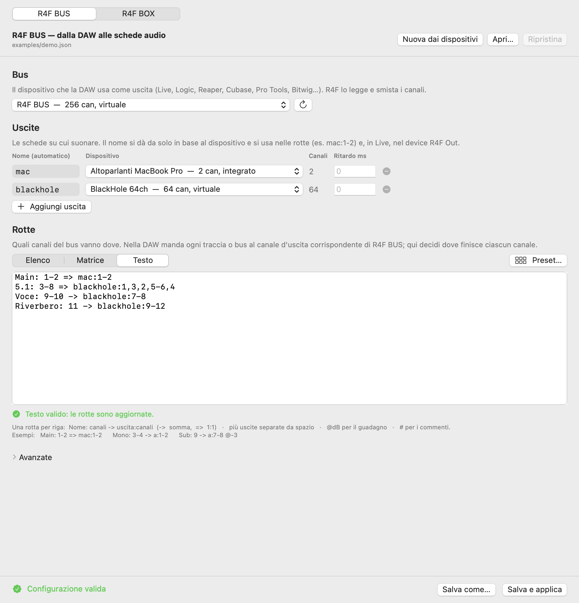

<p align="center">
  
</p>

<h1 align="center">R4F</h1>

<p align="center">
  Audio multicanale per macOS: dalla DAW a più schede audio, e da un programma all'altro.<br>
  <a href="#licenza">GPL-3.0</a> · macOS 13+ · Apple Silicon e Intel
</p>

---

**R4F** è composto da due schede audio virtuali da 256 canali e da un'app nella barra dei menu che le
gestisce.

- **R4F BUS** manda le tracce di **qualsiasi DAW** (Ableton Live, Logic Pro, Reaper, Cubase/Nuendo,
  Pro Tools, Bitwig…) a **una o più schede audio**, anche quando hanno clock diversi.
- **R4F BOX** **passa l'audio da un programma all'altro**, con una matrice di instradamento.

> *English:* R4F is a macOS multichannel audio toolkit: two 256-channel virtual audio devices (R4F BUS, R4F BOX)
> and a menu bar app. Route tracks from any DAW to multiple audio interfaces with clock drift correction,
> and route audio between applications through a driver-side routing matrix. Interface and docs are in Italian.

```
DAW ──▶ R4F BUS ──▶ app R4F (matrice + correzione della deriva) ──▶ scheda A, scheda B, …
programma 1 ──▶ uscite R4F BOX ──[matrice nel driver]──▶ ingressi R4F BOX ──▶ programma 2
```

## Caratteristiche

**R4F BUS: dalla DAW alle schede audio**
- Ogni canale può andare a una, a molte o a nessuna uscita, su più schede insieme.
- La deriva tra i clock delle schede è corretta da un **ricampionatore polifase per ogni scheda**
  (sinc con finestra di Kaiser, 64 tap, SNR > 100 dB in simulazione). Il controllo combina i dati di
  CoreAudio e un regolatore PI sul riempimento del buffer.
- La latenza delle schede viene allineata da sola, e si può aggiungere un ritardo a mano per ogni uscita.
- Si riavvia da solo quando cambi la configurazione, colleghi o scolleghi una scheda, o la DAW cambia
  la frequenza di campionamento.
- Protezioni: avviso **CLIP** sopra 0 dBFS, e blocco degli **anelli di retroazione**, cioè un'uscita
  che riscrive nel bus.

**R4F BOX: tra programmi**
- Un programma suona sulle uscite della BOX, un altro registra dai suoi ingressi.
- La matrice uscite → ingressi lavora **dentro il driver**: nessuna latenza in più, nessuna deriva e
  attiva anche ad app chiusa. Di default è 1:1.

**L'editor**, uguale per BUS e BOX
- Tre viste sincronizzate delle rotte: **Elenco**, **Matrice** (clic e trascinamento) e **Testo**
  (`Nome: 3-4 -> mac:1-2 @-3`).
- **Modo** per ogni rotta: **Somma**, dove ogni canale va su tutte le uscite a 1/N senza che il livello
  salga mai, oppure **1:1**, in coppia.
- **Preset**: stereo, LCR, quadrifonia, 5.0, 5.1, 7.1, 7.1.4, anello di 8, Ambisonics di 1°, 2° e 3°
  ordine. Per i formati surround l'ordine dei canali è SMPTE/ITU o Film, scelto separatamente per la DAW
  e per gli altoparlanti.
- Nomi delle rotte, nomi automatici delle uscite dal dispositivo (`mac`, `fireface`…), controllo di
  ogni riga mentre scrivi.

**Integrazioni**
- Device Max for Live **R4F Out**, facoltativo: sceglie da solo un canale libero di R4F BUS per la traccia,
  imposta Audio To e salva le destinazioni nel Set.
- Controllo OSC su `127.0.0.1:7400`.

## Screenshot

| Elenco delle rotte | Matrice |
|---|---|
|  |  |
| **Testo** | **R4F BOX** |
|  |  |

<p align="center"></p>

## Installazione dal sorgente

Servono macOS 13 o successivo e i **Command Line Tools** (`xcode-select --install`). Xcode non serve.

```bash
git clone <url-di-questo-repository> r4f && cd r4f
```

```bash
Scripts/fetch_blackhole.sh
```

```bash
driver/build.sh
```

```bash
sudo driver/install.sh
```

```bash
Scripts/build_app.sh
```

1. `fetch_blackhole.sh` scarica il sorgente di BlackHole v0.7.2 (GPL-3.0), da cui derivano i driver.
2. `build.sh` compila R4F BUS e R4F BOX (`bus` o `box` per compilarne uno solo).
3. `install.sh` li copia in `/Library/Audio/Plug-Ins/HAL` e riavvia CoreAudio. Per qualche secondo l'audio
   di tutte le app si ferma: chiudi prima la DAW.
4. `build_app.sh` compila e installa `/Applications/R4F.app`.

Al primo avvio R4F chiede il **permesso microfono**, necessario per leggere R4F BUS, e crea una
configurazione con i dispositivi presenti.

Per disinstallare: `sudo driver/uninstall.sh` (oppure `bus` o `box`), poi elimina `/Applications/R4F.app`.

> I binari sono firmati solo localmente (ad-hoc) e non sono notarizzati: il modo previsto per usarli è
> compilarli sul proprio Mac.

## Uso

### Dalla DAW alle schede audio (R4F BUS)

1. Nella DAW scegli **R4F BUS** come dispositivo d'uscita e attiva i canali che ti servono.
2. Manda ogni traccia o bus a un'**uscita hardware** di R4F BUS: canale 5, coppia 7/8, bus 5.1 su 11-16…
3. In **R4F → Configura R4F BUS…** aggiungi le schede e decidi dove finisce ogni canale del bus.

| DAW | dove si sceglie l'uscita della traccia (i menu possono cambiare tra versioni) |
|---|---|
| Ableton Live | Audio To → Ext. Out → canale, oppure il device **R4F Out** |
| Logic Pro | strip → slot Output → Output N |
| Reaper | pulsante di routing della traccia → uscita hardware |
| Cubase / Nuendo | Audio Connections → Outputs |
| Pro Tools | I/O Setup → Output (i formati surround usano di solito l'ordine **Film**) |
| Bitwig | bus d'uscita nelle impostazioni audio |

Il bus 1-2 è di solito l'uscita principale della DAW.

### Da un programma all'altro (R4F BOX)

1. Nel programma che manda, scegli **R4F BOX** come uscita.
2. Nel programma che riceve, scegli **R4F BOX** come ingresso.
3. In **R4F → Configura R4F BOX…** puoi spostare, sommare o silenziare i canali.

Esempi: `1-2 => in:5-6` sposta una coppia, `1-4 -> in:1-2` somma quattro canali su due.

### Sintassi delle rotte

```
Nome: canali -> uscita:canali [@dB]     somma: ogni canale su tutte le destinazioni, a 1/N
Nome: canali => uscita:canali [@dB]     1:1, in coppia
```

I canali si scrivono come `5`, `1-8` o `1,3,5-6`. Una riga può avere più destinazioni separate da spazio,
e `#` inizia un commento.

## Configurazione

- `~/Library/Application Support/R4F/config.json`: R4F BUS.
- `~/Library/Application Support/R4F/box.json`: R4F BOX.
- Log: `~/Library/Logs/R4F.log`.

```json
{
  "bus": "R4F BUS",
  "outputs": [
    { "id": "mac", "device": "Altoparlanti MacBook Pro" },
    { "id": "fireface", "device": "Fireface UCX II" }
  ],
  "routes": [
    { "name": "Main", "from": "1-2", "to": "mac:1-2", "mode": "pair" },
    { "name": "5.1", "from": "3-8", "to": "fireface:1,3,2,5-6,4", "mode": "pair" },
    { "name": "Voce", "from": "9-10", "to": "fireface:7-8", "mode": "sum", "gainDb": -3 }
  ]
}
```

Campi facoltativi:
- `bufferFrames`, `safetyFrames`, `alignOutputs`, `feedForward`, `oscPort`, `statusFile`;
- `delayMs` per ogni uscita.

Altri esempi sono in [`examples/`](examples/).

## OSC e riga di comando

```
/livebus/route <bus> <uscita> <canale> [dB]        /livebus/unroute <bus> <uscita> <canale>
/livebus/set <owner> <canali bus> <destinazioni> [dB]   /livebus/release <owner>
/livebus/clear    /livebus/load <file.json>    /livebus/routes
```

Il binario `.build/release/livebus` offre anche questi comandi:

| comando | cosa fa |
|---|---|
| `run <config.json>` | router da terminale (da non usare insieme all'app) |
| `devices` | elenco dei dispositivi audio |
| `default-config` | configurazione che verrebbe creata |
| `selftest` | test di logica, deriva e qualità |
| `bench` | carico della CPU |
| `tone` | tono di prova su un dispositivo |

## Test

```bash
swift build -c release && .build/release/livebus selftest
```

```bash
driver/build/drivertest driver/build/R4FBUS.driver 256
```

```bash
driver/build/drivertest driver/build/R4FBOX.driver 256 --box
```

```bash
node device/test/harness.js
```

- `selftest` copre il parser delle rotte, l'editor (matrice, testo, preset, nomi, modi), gli anelli e
  la BOX. Simula anche due schede con una deriva di +80 e −120 ppm per 5 minuti: nessun xrun e SNR > 100 dB.
- `drivertest` carica i driver senza installarli e verifica canali e loopback bit-exact. Per la BOX
  controlla anche la matrice: 1:1 di default, media, fan-out, canali muti, salvataggio e costo per ciclo.
- `harness.js` esegue il device Max for Live contro una Live API simulata.

## Struttura

| percorso | contenuto |
|---|---|
| `Sources/CLiveBus/` | motore real-time in C: ring buffer, ricampionatore, controllo della deriva |
| `Sources/livebus/` | app R4F e riga di comando (Swift, AppKit e SwiftUI) |
| `driver/` | build e installazione dei driver; `r4fbox/` genera il sorgente di R4F BOX; `test/` contiene l'host di prova |
| `device/` | device Max for Live R4F Out e i suoi test |
| `Scripts/` | build dell'app, icona, download di BlackHole |
| `assets/` | logo e icona |
| `examples/` | configurazioni d'esempio |

## Licenza

R4F è distribuito sotto licenza **GNU General Public License v3.0**: vedi [`LICENSE`](LICENSE).

I driver derivano da [BlackHole](https://github.com/ExistentialAudio/BlackHole) di Existential Audio Inc.
(GPL-3.0). Il nome e il logo "BlackHole" sono marchi di Existential Audio e non sono usati da R4F, che non
è affiliato a Existential Audio né approvato da essa. Dettagli, attribuzioni e marchi sono in
[`NOTICE.md`](NOTICE.md). Il registro delle modifiche è in [`CHANGELOG.md`](CHANGELOG.md).
